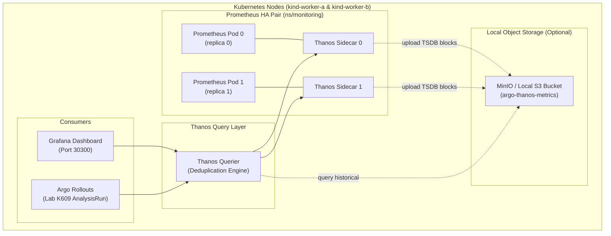

# Architecture Plan: Prometheus High Availability (HA) with Thanos

This plan outlines the design and implementation strategy to equip the Argo Bootcamp cluster with a High-Availability (HA) Prometheus setup powered by **Thanos**.

---

## 1. Executive Summary & Goals

In the current setup, **kube-prometheus-stack** runs a single Prometheus replica. While sufficient for local labs, production Kubernetes environments and automated canary analysis (Argo Rollouts `AnalysisTemplate`) require:
1. **High Availability (HA)**: Dual Prometheus replicas scraping identical targets without single points of failure.
2. **Transparent Deduplication**: Merging metrics from duplicate replicas so query consumers (Grafana, Argo Rollouts) see seamless time-series data without double-counting.
3. **Course Manifest Compatibility**: Lab K609 queries:
   `http://prom-kube-prometheus-stack-prometheus.monitoring.svc.cluster.local:9090`
   The Thanos Query layer must transparently satisfy or proxy this address so students don't have to alter course YAML files.
4. **Long-Term Storage (Optional / Extensible)**: Shipping TSDB blocks to MinIO (S3-compatible local object store) via Thanos Sidecar.

---

## 2. High-Level Architecture



---

## 3. Core Components

| Component | Role | Details |
| :--- | :--- | :--- |
| **Prometheus Operator** | Manages Prometheus statefulsets | Configured with `replicas: 2` and pod anti-affinity across `kind-worker-a` and `kind-worker-b`. |
| **Thanos Sidecar** | Injected sidecar per Prometheus pod | Connects to Prometheus 2.x local storage via gRPC; exposes `StoreAPI` to Thanos Query. |
| **Thanos Query (Querier)** | PromQL endpoint & Deduplicator | Evaluates PromQL queries, fan-outs to sidecars, deduplicates metric samples using external labels (`replica: 0` vs `replica: 1`). |
| **Prometheus Service Proxy** | Service compatibility layer | Bridges `prom-kube-prometheus-stack-prometheus:9090` directly to Thanos Query so Lab K609 works verbatim. |
| **MinIO (Local S3)** | Object storage for cold metrics | Lightweight S3-compatible bucket running in KIND to demonstrate long-term metric retention. |

---

## 4. Implementation Steps

### Phase 1: Prometheus Spec Configuration (`values-thanos-ha.yaml`)
Update Helm values for `kube-prometheus-stack`:
```yaml
prometheus:
  prometheusSpec:
    replicas: 2
    replicaExternalLabelName: "replica"
    thanos:
      version: "v0.37.2"
    affinity:
      podAntiAffinity:
        preferredDuringSchedulingIgnoredDuringExecution:
        - weight: 100
          podAffinityTerm:
            labelSelector:
              matchExpressions:
              - key: app.kubernetes.io/name
                operator: In
                values: ["prometheus"]
            topologyKey: kubernetes.io/hostname
```

### Phase 2: Deploy Thanos Query Layer
Deploy Thanos Query using the official `bitnami/thanos` chart or standalone manifest in `ns/monitoring`:
```bash
helm upgrade --install thanos-query bitnami/thanos \
  --namespace monitoring \
  --set query.enabled=true \
  --set query.dnsDiscovery.sidecarsService="prom-kube-prometheus-stack-thanos-discovery" \
  --set query.dnsDiscovery.sidecarsNamespace="monitoring" \
  --set existingObjstoreSecret=""
```

### Phase 3: Course Compatibility DNS Proxy
To ensure that Lab K609's `AnalysisTemplate` query to:
`http://prom-kube-prometheus-stack-prometheus.monitoring.svc.cluster.local:9090`
hits the deduplicated Thanos Querier instead of individual replicas, configure a Service or ExternalName pointing `prom-kube-prometheus-stack-prometheus` to `thanos-query:9090`.

### Phase 4: CLI Integration in `00-bootstrap.sh`
Add a dedicated option or flag:
```bash
./00-bootstrap.sh prometheus --ha-thanos
# or interactive prompt:
# 1) Standard Prometheus (Course Default)
# 2) High-Availability Prometheus with Thanos (Dual Replicas + Deduplication)
```

---

## 5. Verification & Testing Procedure

1. **HA Scraping Check:**
   Verify both Prometheus pods (`prometheus-prom-kube-prometheus-stack-prometheus-0` and `-1`) are running across `kind-worker-a` and `kind-worker-b`.
2. **Deduplication Test:**
   Execute a query in Grafana or via `curl` against Thanos Querier:
   ```bash
   curl -s "http://localhost:30100/api/v1/query?query=up" | jq .
   ```
   Ensure metrics show continuous time series without duplicated data points.
3. **Chaos / Node Failure Simulation:**
   Kill one of the Prometheus pods during a canary rollout:
   ```bash
   kubectl delete pod -n monitoring prometheus-prom-kube-prometheus-stack-prometheus-0
   ```
   Verify that Argo Rollouts `AnalysisRun` in Lab K609 continues querying without metric gaps or failed analysis intervals.
