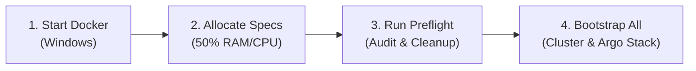

# Ultimate Argo Bootcamp — Student Lab & Training Guide

A complete, beginner-friendly lab companion for the **[Ultimate Argo Bootcamp by School of DevOps®](https://www.udemy.com/course/ultimate-argo-bootcamp-by-school-of-devops/learn/)**.

This repository gives you a pre-configured local Kubernetes environment running on **WSL2 (Ubuntu)** with **kind (Kubernetes in Docker)**, plus all required manifests for GitOps, Progressive Delivery, and CI/CD automation.

---

## 📁 Repository Directory Structure

```text
├── 00-bootstrap.sh                   # Main idempotent lab installer script
├── _scripts/                         # Utility scripts for Windows & WSL host setup
│   ├── set-wsl-resources.bat         # Batch launcher (bypasses execution policy & unblocks file)
│   └── set-wsl-resources.ps1         # PowerShell host hardware allocation script
├── kind-argo.yaml                    # 3-node kind cluster configuration (mirrored mode compatible)
├── k8s-code/                         # Official School of DevOps course manifests (instavote, storage, etc.)
├── kube-ops-view/                    # Cluster visualizer dashboard (deploy on NodePort 32000)
├── README.md                         # This training handbook
├── demo-app/                         # Sample progressive delivery microservice
│   ├── 10-app.yaml                   # Rollout spec, stable & preview services, ingress
│   ├── 40-analysis.yaml              # Prometheus metric queries for automated rollback
│   └── kustomization.yaml            # Kustomize manifest for GitOps tracking
├── gitops/                           # Argo CD declarative applications
│   ├── 10-application.yaml           # Root Argo CD Application
│   ├── 20-imageupdater-annotations.yaml # Lab K608 annotation patch
│   └── ALT-imageupdater-v1-crd.yaml  # Reference v1.x CRD syntax
└── RESOURCES/                        # Official course lab assets
    ├── *.pdf                         # Step-by-step PDF lab instructions (Lab 1 through 8)
    ├── *.url                         # Direct browser shortcuts to School of DevOps tutorials
    ├── LECTURE_NOTES/                # Saved markdown notes from text-only course lectures
    └── _VIDEOS/                      # Downloaded video lectures (sorted and numbered 01-69)
        └── VIDEO_INDEX.md            # Detailed chronological video mapping table
```

---

## 🚀 Quick Start (Up & Running in 4 Steps)



### Step 1: Start Docker Desktop
Ensure Docker Desktop is running on Windows (the whale icon in your taskbar should be steady).

### Step 2: Configure WSL2 Resources (50% RAM & 50% CPU Cores)
Make sure WSL2 has sufficient CPU and RAM allocated to run multi-node clusters and the monitoring stack.

Run [`set-wsl-resources.bat`](file:///_scripts/set-wsl-resources.bat) from Windows CMD or PowerShell:
```cmd
.\_scripts\set-wsl-resources.bat
```
> **What it does:** Calculates 50% of your host RAM and 50% of CPU cores, writes `networkingMode=mirrored` to `C:\Users\<User>\.wslconfig`, and prompts to restart WSL (`wsl --shutdown`).

### Step 3: Run Preflight Check & Docker Cleanup
```bash
./00-bootstrap.sh preflight
```
> **What it does:** Verifies Docker reachability, inspects WSL mirrored networking, and offers an **interactive menu** to wipe old or running containers (`y` to Clean ALL).

### Step 4: Stand Up Cluster & Argo Stack
Run the end-to-end installer:
```bash
./00-bootstrap.sh all
```
> **Interactive Prompts:**
> 1. Prompts you to pick your Kubernetes cluster flavor (Default: **`1) KIND`**).
> 2. Prompts you to pick your Ingress controller (Default: **`1) NGINX Ingress`**).
>
> In ~5–7 minutes, your cluster, Argo CD, Rollouts, Workflows, Events, Prometheus, Grafana, and Image Updater are ready!

---

## 🧭 Step-by-Step CLI Commands Reference

If you prefer to run each step individually as you progress through course modules:

| Command | Purpose | When to Run |
| :--- | :--- | :--- |
| **`./00-bootstrap.sh tools`** | Installs `kind`, `argocd`, `argo`, `argo-events`, `kubectl-argo-rollouts`, and **`k9s`** | Before Section 3 |
| **`./00-bootstrap.sh cluster`** | Interactive prompt to select your cluster provider | Section 3 (Lab K101) |
| **`./00-bootstrap.sh argo`** | Installs Argo CD, Rollouts, Workflows, and Events | Before Section 4 |
| **`./00-bootstrap.sh ingress`** | Interactive prompt: NGINX Ingress, HAProxy, or MetalLB | Before Section 5 (Lab K603) |
| **`./00-bootstrap.sh prometheus`** | Deploys Prometheus & Grafana (`prom` release) | Before Section 9 (Lab K609) |
| **`./00-bootstrap.sh imageupdater`**| Installs Argo Image Updater (`v0.18.0`) | Before Section 8 (Lab K608) |
| **`./00-bootstrap.sh down`** | Tears down local cluster and frees memory | End of study |

---

## ☸️ Supported Kubernetes Cluster Runtimes

You can specify your cluster runtime directly or let the script prompt you:

```bash
./00-bootstrap.sh cluster                 # Interactive prompt
# Or pass directly:
./00-bootstrap.sh cluster kind            # Default: 3-node KIND cluster (Lab K101)
./00-bootstrap.sh cluster docker-desktop  # Built-in Kubernetes in Docker Desktop (Windows)
./00-bootstrap.sh cluster minikube        # Multi-node Minikube with Docker driver
./00-bootstrap.sh cluster k3d             # 3-node K3s in Docker (Traefik disabled)
./00-bootstrap.sh cluster microk8s        # Canonical MicroK8s
./00-bootstrap.sh cluster k0s             # Mirantis k0s in Docker
```

### Runtime Comparison & Course Compatibility:

| Runtime | Deployment Model | How to Use & Prerequisites | Course Compatibility |
| :--- | :--- | :--- | :--- |
| **`kind`** *(Default)* | Containers in Docker | Run `./00-bootstrap.sh cluster kind`. Starts 3 container nodes (`kind-control-plane`, `kind-worker-a`, `kind-worker-b`) with host ports `80`, `443`, NodePorts `30000–30800`, `32000`, and `0.0.0.0` API binding. | **100% Verbatim** — Matches all course labs, NodePorts, and multi-node exercises. |
| **`docker-desktop`** | Windows Host VM / WSL2 | 1. In Docker Desktop Settings → Kubernetes, check **Enable Kubernetes**.<br>2. Run `./00-bootstrap.sh cluster docker-desktop` to bind `kubectl` to `context: docker-desktop`. | **High** — Single node; services map directly to Windows `localhost`. |
| **`minikube`** | Multi-node in Docker | Run `./00-bootstrap.sh cluster minikube`. Automatically downloads `minikube` CLI and launches a 3-node cluster with ports mapped. | **High** — Supports multi-node topology and local image loading. |
| **`k3d` / `k3s`** | Lightweight K3s in Docker | Run `./00-bootstrap.sh cluster k3d`. Deploys 3 nodes (1 server, 2 agents) and **disables default Traefik** so NGINX Ingress works cleanly. | **Very High** — Fast boot times, low memory consumption. |
| **`microk8s`** | Snap / Host Systemd | Run `./00-bootstrap.sh cluster microk8s`. Connects to host/VM MicroK8s and enables `dns` and `ingress` addons. | **Medium** — Requires Snap/systemd (not inside bare WSL without systemd enabled). |
| **`k0s`** | Containerized K8s | Run `./00-bootstrap.sh cluster k0s`. Launches a standalone control plane in Docker with ports `80/443/6443` bound to localhost. | **Medium** — Great for standalone testing. |

---

## 🌐 Supported Ingress & LoadBalancer Providers

```bash
./00-bootstrap.sh ingress           # Interactive selection prompt
# Or pass directly:
./00-bootstrap.sh ingress nginx     # Recommended for course Labs K603 & K609
./00-bootstrap.sh ingress haproxy   # HAProxy Ingress controller (L7)
./00-bootstrap.sh ingress metallb   # MetalLB L2 LoadBalancer IP pool for KIND
```

* **`nginx` (Recommended)**: Installs `ingress-nginx` for KIND with admission webhooks. **Strictly required for Lab K603** (`trafficRouting.nginx.stableIngress: vote`) and Lab K609 Prometheus analysis metrics.
* **`haproxy`**: Installs `haproxy-ingress` via Helm as a DaemonSet using hostPorts `80/443`.
* **`metallb`**: Installs MetalLB and automatically provisions an `IPAddressPool` based on your Docker KIND subnet (`172.18.255.200–250`) so `type: LoadBalancer` services get real local IPs.

---

## 🖥️ Web Dashboards & URL Quick Reference

All ports are mapped to `0.0.0.0` for direct access from your Windows browser:

### 1. Argo CD Web UI
* **URL:** [https://localhost:8081](https://localhost:8081)
* **Start Port-Forward:**
  ```bash
  kubectl -n argocd port-forward svc/argocd-server 8081:443 --address 0.0.0.0
  ```
* **Username:** `admin`
* **Get Password:**
  ```bash
  kubectl -n argocd get secret argocd-initial-admin-secret -o jsonpath='{.data.password}' | base64 -d && echo
  ```

### 2. Argo Workflows UI
* **URL:** [http://localhost:8001](http://localhost:8001) (auto-forwarded via worker port 8080)
* Or forward manually:
  ```bash
  kubectl -n argo port-forward svc/argo-server 2746:2746 --address 0.0.0.0
  # Open http://localhost:2746
  ```

### 3. Prometheus & Grafana
* **Prometheus:** [http://localhost:30100](http://localhost:30100)
* **Grafana:** [http://localhost:30300](http://localhost:30300) (`admin` / `prom-operator`)

### 4. Demo Application & Canary Ingress
* **App URL:** [http://localhost](http://localhost) (Host header: `podinfo.example.com`)
* **Simulate Canary Traffic:**
  ```bash
  while true; do
    curl -s -o /dev/null -w "%{http_code}\n" -H "Host: podinfo.example.com" http://localhost/version
    sleep 0.3
  done
  ```

---

## 🗺️ Course Roadmap & Hands-on Lab Walkthrough

| Module / Lab | Topic | Videos | Guide & Manifests | What You Do & Learn |
| :--- | :--- | :---: | :--- | :--- |
| **Module 01 & 02** | **Argo Ecosystem Overview** | `01` – `10` | [`ArgoWorkshop.pdf`](./RESOURCES/ArgoWorkshop-2705202401.pdf) | GitOps principles, CRD architecture, and how Argo components connect. |
| **Lab K101** | **Multi-Node Cluster Setup** | `04` – `10` | [`Lab 1 KIND Cluster.pdf`](./RESOURCES/Lab+1+-+Create+Kubernetes+Cluster+with+KIND.pdf)<br>[`kind-argo.yaml`](./kind-argo.yaml) | Provision 1 control-plane and 2 worker nodes (`kind-worker-a`, `kind-worker-b`). |
| **Lab K602** | **Blue/Green Releases with Rollouts**| `11` – `18` | [`Lab 2 Blue Green.pdf`](./RESOURCES/Lab+2+-++Blue+Green+Releases+with+Argo+Rollouts.pdf)<br>[`demo-app/10-app.yaml`](./demo-app/10-app.yaml) | Replace Deployments with Argo Rollouts using active & preview services. |
| **Lab K603** | **Canary Progressive Delivery** | `19` – `28` | [`Lab 3 Canary Release.pdf`](./RESOURCES/Lab+3+-++Implementing+Canary+Release+for+Prod.pdf)<br>[`00-bootstrap.sh ingress`](./00-bootstrap.sh) | Route traffic dynamically (`canary-weight: 20` ... `80`) with NGINX Ingress. |
| **Lab K604** | **GitOps with Argo CD** | `29` – `41` | [`Lab 4 ArgoCD.pdf`](./RESOURCES/Lab+4+-++Setting+up+Automated+Deployments+with+ArgoCD.pdf)<br>[`gitops/10-application.yaml`](./gitops/10-application.yaml) | Connect Git repositories to Kubernetes with auto-sync and self-healing. |
| **Lab K606** | **CI Pipelines with Workflows** | `42` – `51` | [`Lab 5 Workflows.pdf`](./RESOURCES/Lab+5+-+CI+Pipeline+with+Argo+Workflows.pdf) | Native containerized CI pipelines with Directed Acyclic Graphs (DAG). |
| **Lab K607** | **Event Automation with Events** | `52` – `58` | [`Lab 6 Argo Events.pdf`](./RESOURCES/Lab+6+-+Event+Based+Automation+with++Argo+Events.pdf) | EventSources and Webhook Sensors triggering CI workflows on Git push. |
| **Lab K608** | **Argo Image Updater** | `59` – `62` | [`Lab 7 Image Updater.pdf`](./RESOURCES/Lab+7+-+Argo+Image+Updater.pdf)<br>[`gitops/20-annotations.yaml`](./gitops/20-imageupdater-annotations.yaml) | Auto-update container images in Git via `v0.18.0` annotations. |
| **Lab K609** | **Automated Analysis & Rollbacks** | `63` – `69` | [`Lab 8 Prometheus.pdf`](./RESOURCES/Lab+8+-+Automated+Analysis+and+Experiments+with+Prometheus+and+Grafana.pdf)<br>[`demo-app/40-analysis.yaml`](./demo-app/40-analysis.yaml) | Automated rollbacks based on live Prometheus latency and error metrics. |

> Detailed chronological video index: [`RESOURCES/_VIDEOS/VIDEO_INDEX.md`](./RESOURCES/_VIDEOS/VIDEO_INDEX.md)

---

## ⚠️ 3 Golden Rules (Gotchas to Avoid)

### 1. Check Your Active Kubernetes Context
If you have cloud clusters (e.g. AWS EKS) in your kubeconfig, ensure your active context points to the local lab:
```bash
kubectl config current-context          # Should be: kind-kind
kubectl config use-context kind-kind    # Switch if needed
```

### 2. WSL2 Mirrored Networking Rule
Your WSL2 environment uses `networkingMode=mirrored`:
* Always bind port-forwards to `0.0.0.0` (not `127.0.0.1`), e.g. `--address 0.0.0.0`.
* Never modify `kind-argo.yaml`'s API server IP to `127.0.0.1`, or Windows clients and browsers will not connect.

### 3. Argo Image Updater: Annotations vs CRD
* Course **Lab K608** teaches configuring Image Updater with **annotations** on the Application.
* Modern Image Updater `v1.x` removed annotation support in favor of an `ImageUpdater` CRD.
* This environment installs **`v0.18.0`** so course manifests work verbatim out-of-the-box.
